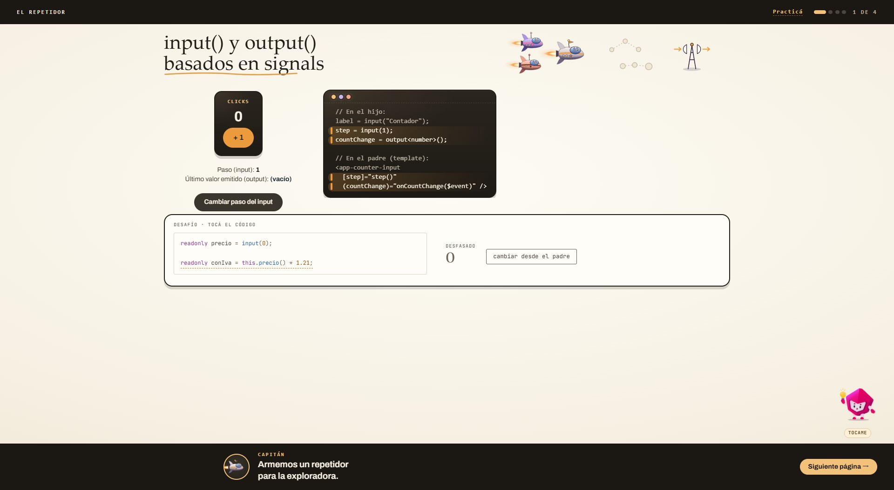

# Angular Signals — Interactive Introduction

An interactive playground for learning **Angular Signals** from the ground up.
Instead of reading about reactivity, you _watch it happen_: every concept is a
small, self-contained screen where you can click, type and toggle to see how
signals, `computed`, `effect` and change detection actually behave.

**[▶ Open the live playground](https://damiansire.github.io/angular-signals-playground/)** — no install, runs in the browser.



The default entry (`/`) is the **integrated view**: a story you play. After the
hill and a prologue, the trip goes stage by stage through the 11 chapters, and
each stage is a sheet that embeds the _real_ demo component of that lesson.
Deep-links are shareable: `?nivel=1&sub-nivel=2` reopens that same sheet.

## Played like a small RPG

The tour has a story. A crew of RxJS ships is dragged out of "Zone.js space" into a world of
molecules where none of their operators work, and a guide (the Angular mascot) offers to teach
them the rules. Each concept is a chapter of that trip:

- **A cinematic per chapter.** The first time you stop at a concept, a short cutscene sets up
  the rule of that chapter as an incident of the crew (portrait and name of who speaks, one line
  at a time). `Enter` advances, `Esc` skips. The finale lights up only the chapters you actually
  established, so unfinished ones stay visible as debt.
- **Challenges you solve by touching the code.** Every sub-level ends with a system whose code has
  a movable part and a reading that answers. The reading stays neutral until there is enough
  evidence, turns red if the system is broken and green once you fix it. No "well done" banner:
  the numbers are the answer.
- **Saved progress.** What you establish is stored in your browser (`localStorage`,
  `signals-cuaderno`): reload and the trip picks up where you left it. "Empezar de cero", on the
  first screen, wipes it.
- **Sound that works on any machine.** Everything is synthesized with one Web Audio context
  (characters "talk" with RPG-style blips), except their lines in the prologue, the cinematics and
  the journey pages, where they speak with voices pre-generated with Gemini TTS
  ([docs/voces.md](./docs/voces.md)) and fall back to the blips. Without
  audio support it simply stays silent. One switch mutes everything.
- **Screening room.** `/cine/6` plays a chapter's cinematic directly, and `/cine/6?cuadro=<beat>`
  freezes one frame, useful to review scenes.

Scripted motion is CSS (springs solved by hand and fed to `linear()`, View Transitions for the iris,
lazy-loaded scenes). What answers the pointer (the mascot you can grab and stretch, the signal graphs
you can poke) runs on hand-rolled springs sharing one clock that sleeps when nothing moves: no
perpetual `requestAnimationFrame`, no expensive filters on moving things, and everything freezes when
the tab is hidden or honors `prefers-reduced-motion`. The scenes of the on-board manual and the
crew of the trip are the exception: they are scripted with GSAP timelines.

Built with **Angular 22** (standalone components, `OnPush` everywhere, signal-first
APIs) and styled with **Tailwind CSS**.

## Why this exists

Signals are the biggest shift in Angular's reactivity model in years. This repo
turns the official mental model into a guided, hands-on tour — useful both as a
self-teaching resource and as a live demo for talks and workshops.

## Learning path

The content is organized as progressive **levels**, each with focused sub-levels:

| Level  | Topic                                      | What you explore                                                                                                                                                 |
| ------ | ------------------------------------------ | ---------------------------------------------------------------------------------------------------------------------------------------------------------------- |
| **0**  | Introduction                               | How Angular renders the DOM tree, classic change detection vs. signal-based change detection, HTML-to-tree visualization                                         |
| **1**  | Interacting with signals                   | Writable signals, `set` vs. `update`, read-only signals, the different kinds of signals                                                                          |
| **2**  | Computed signals                           | Derived state, dynamic dependencies, lazy evaluation & memoization                                                                                               |
| **3**  | Effects                                    | `effect()`, cleanup with `onCleanup`, what happens when a component is destroyed                                                                                 |
| **4**  | Equality functions                         | Custom equality and when a signal _doesn't_ notify its consumers                                                                                                 |
| **5**  | `linkedSignal`                             | Writable state derived from a source: reset on change, or preserve if still valid                                                                                |
| **6**  | `resource` / `rxResource` / `httpResource` | Async signals: `value`/`status`/`error`/`isLoading` with a Promise, an RxJS stream, or a real HTTP request                                                       |
| **7**  | `input` · `model` · `output` · forms       | Signal-based component APIs: `input()`/`output()`, two-way `model()`, `input.required()` and `transform`, and Signal Forms (`form()`, validators, `[formField]`) |
| **8**  | Queries & interop                          | `viewChild()`/`viewChildren()` and `contentChild()`/`contentChildren()` as signals, `toSignal()`/`toObservable()`, `untracked()`                                 |
| **9**  | `afterRenderEffect` & `onCleanup`          | Reading/measuring the DOM after render, and cleaning up effects without leaks                                                                                    |
| **10** | Debounced signals                          | A debounced value, three ways: RxJS (`debounceTime`), by hand (`effect` + `onCleanup`), and the native `debounced()` (experimental in v22)                       |
| **11** | Capstone: zoneless                         | Why signals + OnPush let Angular drop Zone.js (the default since v21; `provideZoneChangeDetection()` brings it back)                                             |

## Getting started

```bash
# 1. Install dependencies
npm install

# 2. Start the dev server (http://localhost:4200)
npm start
```

> **Requirements:** Node.js 22 or newer (that is what `package.json` `engines` and
> `.nvmrc` pin, and what CI runs) and a Chromium-based browser for the unit tests.

## Available scripts

| Script                 | Description                                                       |
| ---------------------- | ----------------------------------------------------------------- |
| `npm start`            | Dev server with HMR at `http://localhost:4200`                    |
| `npm run build`        | Production build into `dist/angular-examples`                     |
| `npm run watch`        | Rebuild on change (development configuration)                     |
| `npm test`             | Unit tests (Karma + Jasmine)                                      |
| `npm run lint`         | Lint with ESLint + `angular-eslint`                               |
| `npm run format`       | Format `src/` with Prettier                                       |
| `npm run format:check` | Check formatting without writing                                  |
| `npm run gate:prosa`   | Prose budget per screen (ratchet: fails if a screen gets wordier) |
| `npm run test:scripts` | Unit tests for the gate scripts themselves (`node --test`)        |

CI runs `lint`, `format:check`, `test:scripts`, `gate:prosa`, `test` and the
production `build` on every pull request, and GitHub Pages only deploys a commit
whose CI run went green.

## Tech stack

- **[Angular 22](https://angular.dev)** — standalone components, signals, `@if`/`@for` control flow
- **[`@angular/build`](https://angular.dev/tools/cli/build)** — esbuild/Vite-based toolchain
- **[Tailwind CSS](https://tailwindcss.com)** — utility-first styling
- **ESLint + angular-eslint** — linting and Angular best-practice rules

## Project structure

```
src/app/
├── integrada-vista/  # The default entry (/): the hill, the prologue and the trip through the 11 chapters
│   └── cinematicas/  # Chapter cinematics: player, scripts and one lazy scene per chapter
├── signals/          # The learning levels (0–11), their sub-levels and the concept tree
├── practice/         # Applied examples that use what you learned (/practica/*)
├── components/       # Feature components (histories, trees, forms…)
├── components-atom/  # Atomic UI building blocks (code block, concept card, title…)
├── components-draw/  # Drawing components (the living mascot, the signal circuit, the crew)
├── layouts/          # Reusable page layouts (column + code)
├── libs/             # Framework-agnostic helpers (HTML parser, saved game, sound, springs)
├── interfaces/       # Shared TypeScript types
└── app.routes.ts     # Router routes: the integrated view, the practice and the screening room
```

Areas depend in one direction only, from the base up to the story: `libs`/`interfaces` →
`components-draw` → `components-atom` → `components`/`layouts` → `signals`/`practice` →
`integrada-vista`. The map is `PUEDE_IMPORTAR` in `eslint.config.js`, so `npm run lint` fails on
an import that crosses it ([ADR 0024](./docs/adr/0024-las-areas-dependen-en-una-sola-direccion.md)).

### Conventions

- **Change detection:** every component uses `ChangeDetectionStrategy.OnPush`, and
  the state that drives the view is held in **signals**: nothing calls
  `markForCheck()`.
- **Standalone components** with explicit `imports` — no `NgModule`s.

## Non-goals

This is a **teaching playground**, not a library:

- It is **not** a reusable component or state library to `npm install`. The demos are meant to be read and run, not consumed as a dependency.
- It does **not** try to cover all of Angular, only the **signals** surface (reactivity, `computed`, `effect`, `resource`, zoneless).
- The integrated view is a visual explainer, not a production UI pattern to copy verbatim.

## Contributing

Bug fixes, new signals lessons and documentation improvements are welcome — see
[CONTRIBUTING.md](./CONTRIBUTING.md). To report a security issue, see
[SECURITY.md](./SECURITY.md).

## License

Released under the [MIT License](./LICENSE).
